<p>
  ☕ <strong>Si cette carte vous est utile, vous pouvez soutenir le projet :</strong>
</p>

<div style="white-space: nowrap; line-height: 0;">
  <a
    href="https://www.buymeacoffee.com/Marlboro62"
    target="_blank"
    rel="noopener noreferrer"
    style="display: inline-block; text-decoration: none; vertical-align: middle;"
  ></a>&nbsp;&nbsp;<a
    href="https://ko-fi.com/M4M2QL45X"
    target="_blank"
    rel="noopener noreferrer"
    style="display: inline-block; text-decoration: none; vertical-align: middle;"
  ></a>
</div>


# Carte Météo

Cartes Lovelace pour Home Assistant, **en français**, toutes dans un seul fichier :

| Carte | Type | Ce qu'elle affiche |
| --- | --- | --- |
| **Météo** | `custom:meteo-card` | La météo du jour, une ou plusieurs villes en onglets : conditions, ressenti, vent, humidité, pression, détails et **vigilance Météo-France**, **prévisions par heure et par jour**, saison, lune et zodiaque |
| **Vent et ciel** | `custom:meteo-ciel-card` | **Baromètre**, **boussole du vent**, températures de vos capteurs, **pluie du jour**, **indice UV** et carte **Windy** |
| **Soleil et lune** | `custom:meteo-astro-card` | **Course du soleil** (boussole, aube, lever, midi, coucher, crépuscule, durée du jour), **lune** (lever, coucher, éclairement, fenêtre des phases), cycles, **étoiles filantes**, **activité solaire et aurores** (indice Kp, éruptions) et **pollens** |
| **Air, pollens et eau** | `custom:meteo-air-card` | **Qualité de l'air** et polluants (Atmo France), **pollens** avec niveau et concentration, **vigilance sécheresse** (VigiEau) |
| **Bolides** | `custom:meteo-bolides-card` | **Carte du monde interactive** des bolides (grosses météorites) détectés par la NASA : zoom, bulle au clic, filtres par période et énergie, le plus récent, le plus proche et le plus puissant |
| **EcoWatt** | `custom:meteo-ecowatt-card` | **Risque de coupures d'électricité** : signal EcoWatt de RTE aujourd'hui, demain et après-demain, **heure par heure** (cases cliquables), avec la France à la couleur du jour choisi (MyElectricalData ou RTE EcoWatt) |
| **Crues et rivières** | `custom:meteo-crues-card` | **Hauteur et débit des rivières** proches avec leur **tendance sur 24 h** (courbe, hausse ou baisse), **vigilance crues** du département et **carte interactive** des stations (Vigicrues, sans intégration grâce à Hub'Eau) |
| **Feux de forêt** | `custom:meteo-feux-card` | **Feux détectés par satellite** autour de chez vous (NASA FIRMS) : boussole et **carte interactive**, distance et direction, intensité, ville la plus proche, **fumée vers vous ou non**, prochain passage d'un satellite |
| **Séismes** | `custom:meteo-seismes-card` | **Séismes autour de chez vous** sur une boussole (direction, distance, magnitude), en liste et sur une **carte interactive**, et les plus forts **dans le monde** (EMSC et USGS, sans intégration) |
| **Éclairs** | `custom:meteo-eclairs-card` | **Direction et distance** du dernier éclair sur une boussole, **compteur** d'éclairs et total du mois (Blitzortung) |

Elles fonctionnent avec **toute entité météo** (Météo-France, Met.no, OpenWeatherMap…) et trouvent leurs entités toutes seules. Le soleil et la lune sont **calculés d'après les coordonnées de Home Assistant** : aucun capteur ni image à fournir. Les **icônes météo animées** sont celles de la carte Météo-France de HACF (amCharts).

*Basées sur les idées et la vue météo partagées par [@WarC0zes](https://forum.hacf.fr/u/warc0zes/summary) sur le forum HACF : merci à lui !*

Elles ont le même style que la [Carte Enedis Linky New](https://github.com/Marlboro62/content-card-linky-new) et les [Cartes Linky Énergie](https://github.com/Marlboro62/linky-energie-cards), mais elles sont **indépendantes**.

🎮 **[Essayer la démo en ligne](https://marlboro62.github.io/meteo-card/docs/demo.html)** : les vraies cartes avec des données simulées, sans installer Home Assistant.

| Météo, deux villes en onglets | Vent et ciel | Soleil et lune |
| --- | --- | --- |
| 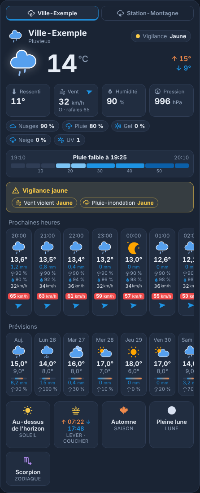 | 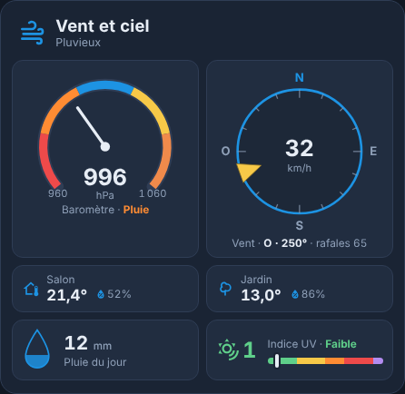 | 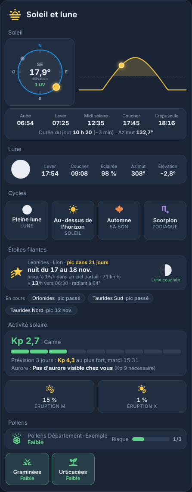 |

| Air, pollens et eau | Éclairs | Phases de la lune (clic sur la lune) |
| --- | --- | --- |
| 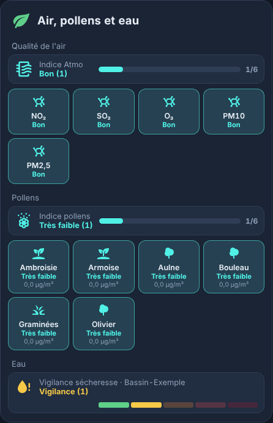 | 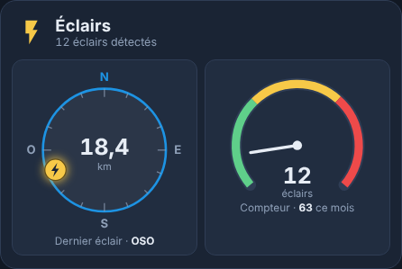 | 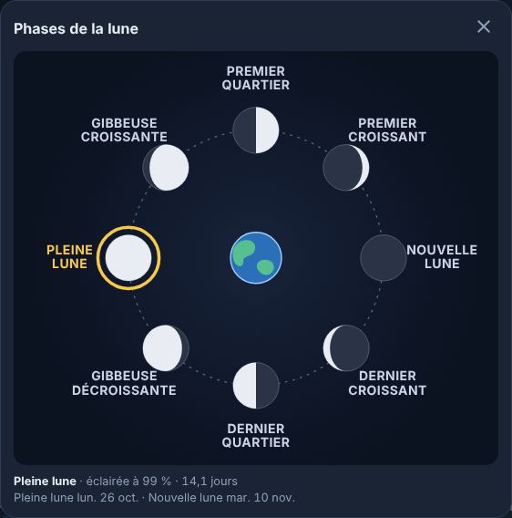 |

| Version claire | Téléphone |
| --- | --- |
| 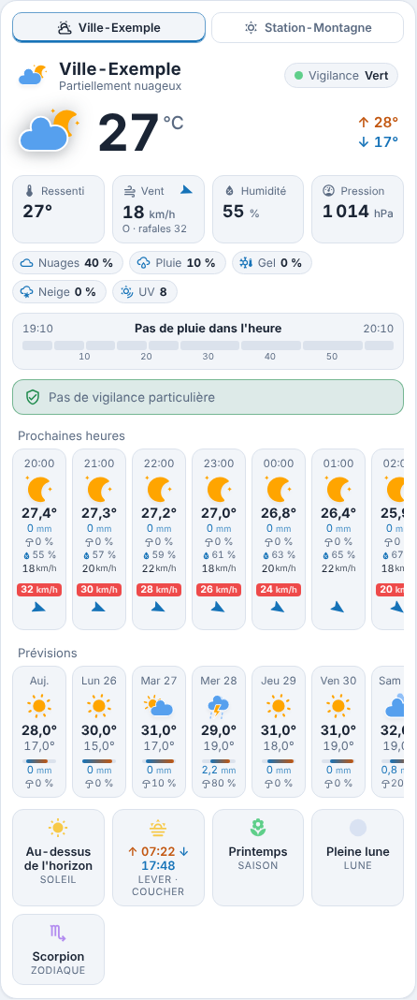 | 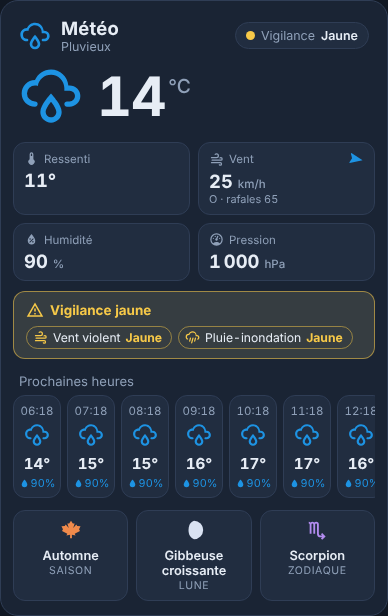 |

| Soleil et lune avec les photos de la lune | Phases de la lune avec les photos de la lune et de la Terre |
| --- | --- |
| 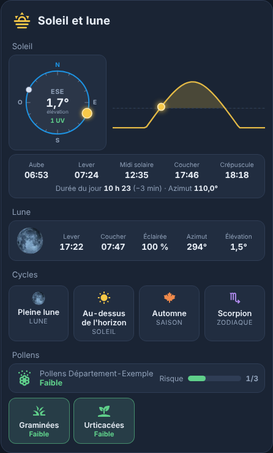 | 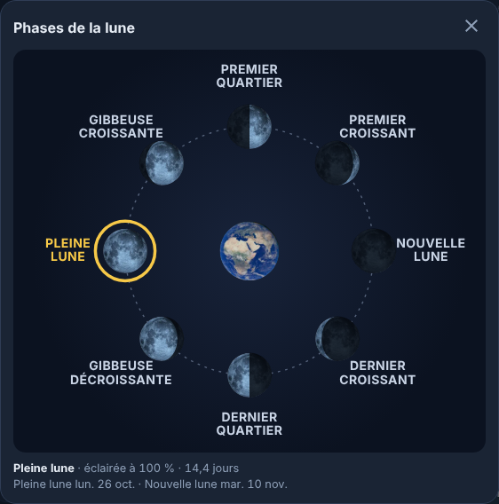 |

| Mode WarC0zes (`layout: warc0zes`, `halo: true`) | Bolides (carte interactive) | Séismes |
| --- | --- | --- |
| 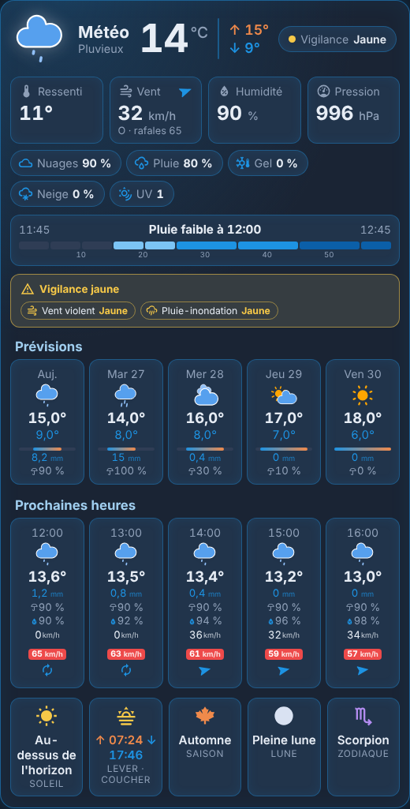 | 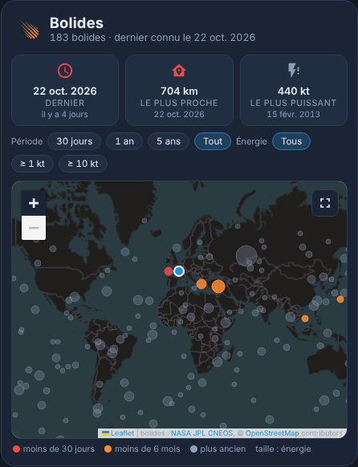 | 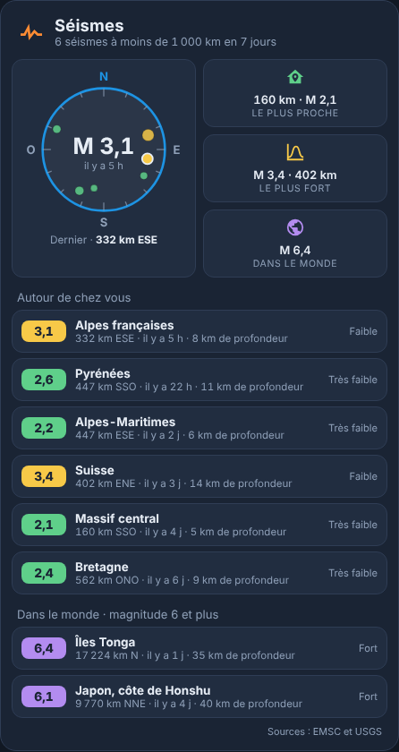 |

| Crues et rivières (démo, crue fictive) | Crues et rivières, mesures réelles (noms et lieux remplacés, carte floutée) | EcoWatt (démo, journée tendue fictive) |
| --- | --- | --- |
| 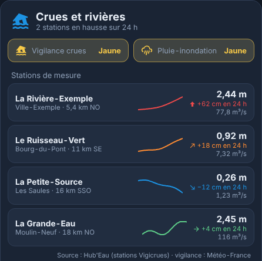 | 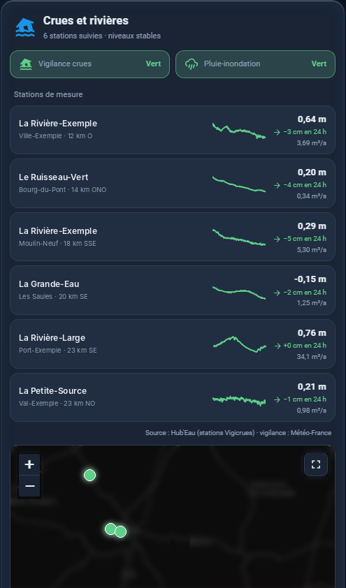 | 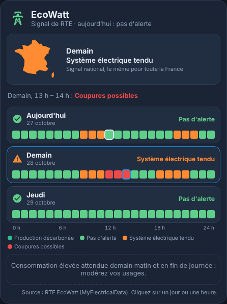 |

| Feux de forêt | Carte interactive des feux (fond flouté) | Carte interactive des séismes |
| --- | --- | --- |
| 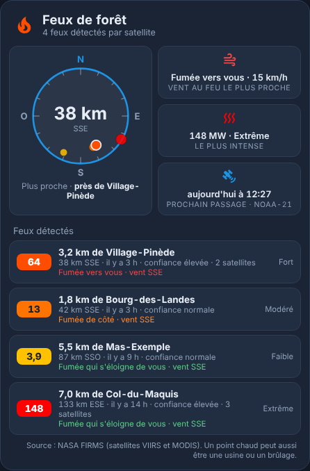 | 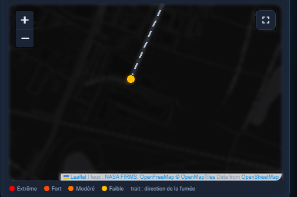 | 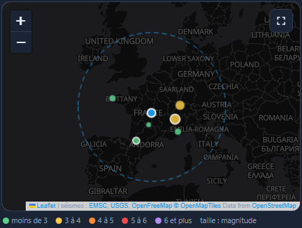 |

*Aperçus avec des villes et des données fictives, sauf la carte interactive des feux et les mesures réelles des rivières : captures réelles, noms remplacés et fond de carte flouté pour qu'aucun lieu ne soit lisible.*

## Remplacer une vue météo « à rallonge »

Une vue météo classique empile une quinzaine de cartes HACS : stack-in-card, tabbed-card, card-mod, meteofrance-weather-card, compass-card, tempometer-gauge-card, rain-gauge-card, uv-index-card, sun-card, button-card, bar-card, auto-entities, popup-card…

Ces cartes font la même chose avec **une seule ressource**, sans CSS à maintenir ni image de phases de lune à positionner à la main. La vue complète est prête dans [`exemples/vue-meteo.yaml`](exemples/vue-meteo.yaml).

## Installation

### Avec HACS (recommandé)

1. Dans HACS, menu **⋮** → **Dépôts personnalisés**.
2. Ajoutez `https://github.com/Marlboro62/meteo-card` avec le type **Tableau de bord** (Dashboard).
3. Cherchez **Carte Météo**, installez-la, puis rechargez la page (Ctrl+F5).

Les cinq cartes apparaissent ensuite dans la liste des cartes, chacune avec son éditeur visuel.

### Manuellement

1. Téléchargez [`meteo-card.js`](https://raw.githubusercontent.com/Marlboro62/meteo-card/main/meteo-card.js) (clic droit → Enregistrer sous) et copiez-le dans `/config/www/`.
2. **Paramètres → Tableaux de bord → ⋮ → Ressources → Ajouter une ressource** :
   - URL : `/local/meteo-card.js`
   - Type : **Module JavaScript**
3. Rechargez la page (Ctrl+F5).

## Photos de la lune et de la Terre (facultatif)

Par défaut, la lune et la Terre sont dessinées par la carte. Pour afficher de vraies photos, comme sur les aperçus ci-dessus :

1. Téléchargez les deux images (clic droit → Enregistrer sous) :
   - [`lune.svg`](https://raw.githubusercontent.com/Marlboro62/meteo-card/main/photos/lune.svg) : pleine lune, assombrie par la carte selon la phase du jour ;
   - [`terre.svg`](https://raw.githubusercontent.com/Marlboro62/meteo-card/main/photos/terre.svg) : la Terre, au centre de la fenêtre des phases.
2. Copiez-les dans `/config/www/images/` (par exemple avec l'add-on **File editor** ou **Samba**).
3. Dans l'éditeur des cartes, renseignez :

```yaml
type: custom:meteo-astro-card
moon_image: /local/images/lune.svg
earth_image: /local/images/terre.svg
```

L'option `moon_image` fonctionne aussi dans la carte Météo (tuile Lune). Vous pouvez utiliser vos propres photos (PNG, JPG ou SVG) : une pleine lune et une Terre bien centrées, sur fond transparent ou noir. Les crédits des photos fournies sont dans la section [Licence](#licence).

## Intégrations Home Assistant à installer

Les cartes affichent les données d'intégrations Home Assistant : installez celles des cartes que vous utilisez. Chaque partie sans capteur est simplement masquée.

| Intégration | Où la trouver | Pour quelle carte | Ce qu'elle fournit |
| --- | --- | --- | --- |
| **Météo-France** | Intégration officielle : **Paramètres › Appareils et services › Ajouter une intégration** | Météo, Vent et ciel | Prévisions, vigilance du département, pluie dans l'heure, nuages, UV (toute autre entité `weather` fonctionne aussi, sans vigilance ni pluie dans l'heure) |
| **Environnement Canada** | Intégration officielle : **Paramètres › Appareils et services › Ajouter une intégration** | Météo | Météo et **alertes** du lieu (avertissements, veilles, avis, bulletins) |
| **Atmo France** | HACS : [sebcaps/atmofrance](https://github.com/sebcaps/atmofrance) | Air, pollens et eau | Qualité de l'air (indice Atmo et polluants) et pollens ; demande un compte gratuit sur [admindata.atmo-france.org](https://admindata.atmo-france.org) |
| **VigiEau** | HACS : [kamaradclimber/vigieau](https://github.com/kamaradclimber/vigieau) | Air, pollens et eau | Vigilance sécheresse par type d'eau et usages autorisés ou interdits |
| **Blitzortung.org Lightning Detector** | HACS : [mrk-its/homeassistant-blitzortung](https://github.com/mrk-its/homeassistant-blitzortung) | Éclairs | Compteur, distance et direction des éclairs autour de chez vous |
| **Pollens** ou **Pollen Information** | HACS : [chris60600/pollens-home-assistant](https://github.com/chris60600/pollens-home-assistant), ou Pollen Information | Soleil et lune | Risque d'allergie et niveau par plante |
| **REST** (intégration officielle, en YAML) | Fichier `packages/…yaml`, voir la carte Bolides | Bolides | Liste des bolides de l'API Fireball de la NASA, publique et sans clé |
| **NOAA Space Weather** (facultatif) | HACS : [tcarwash/home-assistant_noaa-space-weather](https://github.com/tcarwash/home-assistant_noaa-space-weather) | Soleil et lune | Indice Kp, flux solaire, taches solaires, probabilité d'éruption (sans elle, la carte lit directement les données publiques de la NOAA) |
| **Aurora** (facultatif) | Intégration officielle : **Paramètres › Appareils et services › Ajouter une intégration** | Soleil et lune | Probabilité d'aurore à votre position (modèle OVATION de la NOAA) |
| **MyElectricalData** (export Home Assistant) ou **RTE EcoWatt** | Add-on [MyElectricalData](https://github.com/MyElectricalData/myelectricaldata_new) : capteurs `ecowatt_j0` à `ecowatt_j2`, heure par heure ; ou HACS : [kamaradclimber/rte-ecowatt](https://github.com/kamaradclimber/rte-ecowatt), niveau par jour (compte RTE gratuit) | EcoWatt | Signal EcoWatt de RTE pour aujourd'hui, demain et après-demain |
| **Vigicrues** (facultatif) | HACS : [julcollas/hass-vigicrues](https://github.com/julcollas/hass-vigicrues) | Crues et rivières | Hauteur et débit des stations que vous choisissez (sans elle, la carte lit directement Hub'Eau, le service public des données sur l'eau) |
| **NASA FIRMS Wildfire Monitor** | HACS : [bangboomben/ha-nasa-firms](https://github.com/bangboomben/ha-nasa-firms), avec une clé gratuite de la NASA ([MAP_KEY](https://firms.modaps.eosdis.nasa.gov/api/map_key/)) | Feux de forêt | Feux détectés par les satellites VIIRS et MODIS dans le rayon choisi, avec leur intensité, la ville la plus proche, le vent et la direction de la fumée |
| **USGS Earthquake Hazards Program** ou **GDACS** (facultatif) | Intégrations officielles | Séismes | Séismes autour de chez vous (sans elles, la carte lit directement les flux publics de l'EMSC et de l'USGS) |
| **Compteur de services publics** (`utility_meter`) | Intégration officielle : **Paramètres › Appareils et services › Entrées** | Éclairs (facultatif) | Total des éclairs du mois, à partir du compteur Blitzortung |

Le soleil, la lune, les étoiles filantes et la carte **Windy** n'ont besoin d'aucune intégration : ils utilisent les coordonnées de Home Assistant. L'activité solaire et les séismes non plus : sans intégration, le navigateur lit les données publiques de la NOAA, de l'EMSC et de l'USGS.

## Carte Météo

```yaml
type: custom:meteo-card
```

- **Icônes météo** animées ou statiques (jeu amCharts de la carte Météo-France), avec les variantes de nuit d'après l'heure de chaque prévision.
- **En-tête** : icône du temps, ville, conditions en français et une **pastille de vigilance** (vert, jaune, orange, rouge).
- **Maintenant** : température en grand, minimale et maximale du jour.
- **Ressenti, vent, humidité, pression** : le vent avec sa direction (N, NE, E…), une flèche et les rafales. Sans ressenti fourni, la carte le calcule.
- **Détails Météo-France** : nuages, risque de pluie, de gel, de neige, indice UV et heure de la prochaine pluie, lus dans les capteurs Météo-France de la ville.
- **Pluie dans l'heure** (Météo-France) : une barre par tranche de 5 à 10 minutes, « Pas de pluie dans l'heure » ou « Pluie faible à 17:30 ».
- **Vigilance Météo-France** : chaque phénomène actif avec son icône et sa couleur.
- **Alertes Environnement Canada** (Canada) : une ligne par alerte en cours, avec son type (avertissement, veille, avis, bulletin), son titre et son heure de fin, et une pastille « Alertes » dans l'en-tête. Voir [Alertes Environnement Canada](#alertes-environnement-canada).
- **Prévisions** par heure, par jour ou jour et nuit, **l'une sous l'autre** si vous le souhaitez, avec les **mêmes lignes pour les heures et les jours** : température, minimale, pluie en mm (0 mm compris), risque de pluie, humidité, vent, **rafales en rouge** et direction. Seules les lignes que votre intégration fournit sont affichées.
- **Soleil, saison, lune, zodiaque** : soleil au-dessus ou sous l'horizon, heures de lever et de coucher, saison, phase de lune et signe.
- **Plusieurs villes** : des onglets en haut de la carte ; la carte retient l'onglet choisi.

| Option | Rôle | Défaut |
| --- | --- | --- |
| `entity` | Entité météo (`weather.…`) | Météo-France, sinon la première trouvée |
| `entities` | Plusieurs villes en onglets : `weather.…`, ou `{ entity, name, alert, ec_alerts }` | — |
| `title` | Titre (une seule ville) | `Météo` |
| `icon` | Icône à côté du titre | `mdi:weather-partly-cloudy` |
| `alert` | Capteur de vigilance Météo-France (`sensor.…_weather_alert`) | détecté |
| `ec_alerts` | Capteurs d'alertes Environnement Canada (liste), aussi par ville dans `entities` ; `"-"` pour ne pas les afficher | détectés |
| `ec_entry` | Identifiant de l'entrée Environnement Canada, si la carte ne le retrouve pas seule | détecté |
| `forecasts` | Liste parmi `hourly`, `daily`, `twice_daily`, affichées l'une sous l'autre | `[daily]` |
| `hours` | Nombre d'heures des prévisions par heure | `8` |
| `days` | Nombre de jours | `5` |
| `forecast_details` | `full` (toutes les lignes, alignées) ou `compact` (seulement les valeurs utiles) | `full` |
| `hourly_wind`, `hourly_gust`, `hourly_precipitation`, `hourly_humidity`, `hourly_direction` | Prévisions par heure : afficher le vent, les rafales, les précipitations (mm et risque de pluie), l'humidité, la girouette (direction du vent) | `true` |
| `daily_wind`, `daily_gust`, `daily_precipitation`, `daily_humidity`, `daily_direction` | Les mêmes lignes pour les prévisions par jour (et jour et nuit) | `true`, sauf `daily_humidity` : `false` |
| `layout` | Présentation : `classic` (classique) ou `warc0zes` (mode WarC0zes : en-tête sur une ligne avec la température, textes plus grands, mêmes couleurs que le thème choisi) | `classic` |
| `halo` | Halo coloré, avec les deux présentations : bordures et reflets bleus, ou de la couleur principale du thème avec `theme: ha` | `false` |
| `icons` | `animated`, `static` (amCharts), `drawn`, `drawn_static` (dessinées par la carte) ou `mdi` | `animated` |
| `icons_path` | Dossier des icônes amCharts, pour un usage hors ligne (ex. `/local/meteo-icons/`) | jsDelivr |
| `moon_image` | Photo d'une **pleine lune** (PNG, JPG ou SVG, ex. `/local/images/lune.png`) : la carte l'assombrit selon la phase du jour, à la place de la lune dessinée (voir [Licence](#licence) pour la photo utilisée en exemple) | — |
| `season`, `moon`, `zodiac` | Capteurs de saison, phase de lune, zodiaque | détectés, sinon calculés |
| `show_stats`, `show_details`, `show_rain_hour`, `show_alert`, `show_forecast`, `show_sky` | Afficher chaque partie | `true` |
| `theme` | `v2` (bleu nuit MyElectricalData), `auto` (clair ou sombre selon HA), `ha` (thème Home Assistant) | `v2` |
| `text_size` | Taille du texte et de toute la carte, en % (80 à 160) | `100` |

### Alertes Environnement Canada

L'intégration **Environnement Canada** crée 5 capteurs par lieu (par exemple, en français, `sensor.ville_alertes`, `_veilles`, `_avis`, `_bulletins` et `_terminaisons`). Leur état est le nombre d'alertes en cours, leurs attributs le titre et l'heure de chacune.

- **Détection** : la carte prend les capteurs du même lieu que l'entité météo de la ville. Pour la première ville, s'il n'y a pas de vigilance Météo-France, elle prend ceux du premier lieu trouvé. Vous pouvez aussi les indiquer avec `ec_alerts`.
- **Couleur** : quand une alerte apparaît, la carte appelle une fois l'action `environment_canada.get_alerts` pour connaître sa **couleur réelle** (jaune, orange, rouge) et son **heure de fin**. Si l'action n'est pas disponible, la couleur vient du type : avertissement en orange, veille et avis en jaune, bulletin en bleu (information).
- Les **terminaisons** (alertes levées) ne sont pas affichées. Sans alerte, la carte indique « Aucune alerte en cours ».

```yaml
type: custom:meteo-card
entity: weather.ville                 # entité de l'intégration Environnement Canada
ec_alerts:                            # facultatif : détectés
  - sensor.ville_alertes
  - sensor.ville_veilles
  - sensor.ville_avis
  - sensor.ville_bulletins
```

> L'ancienne option `forecast_type` (une seule prévision) reste acceptée. Avec plusieurs villes, la vigilance détectée va à la première ; indiquez `alert` pour les autres.
>
> Les icônes amCharts sont chargées depuis jsDelivr, à une version figée du dépôt de la carte Météo-France. Pour ne rien charger depuis Internet, copiez le dossier [`dist/icons`](https://github.com/hacf-fr/lovelace-meteofrance-weather-card/tree/Meteo-France/dist/icons) dans `/config/www/meteo-icons/` et indiquez `icons_path: /local/meteo-icons/`.

## Carte Vent et ciel

```yaml
type: custom:meteo-ciel-card
temperatures:
  - name: Salon
    entity: sensor.salon_temperature
    humidity: sensor.salon_humidity
windy: true
```

- **Baromètre** de 960 à 1060 hPa avec ses zones : tempête, pluie, variable, beau temps, très sec.
- **Boussole du vent** : flèche tournée vers le centre (le vent vient de là), vitesse, direction et rafales ; une image peut remplir le cadran (par exemple une vue du dessus de votre maison).
- **Températures** : autant de capteurs que vous voulez (intérieur, extérieur, avant, arrière…), avec leur humidité et une flèche de tendance.
- **Pluie du jour** : une goutte qui se remplit jusqu'à `rain_max`.
- **Indice UV** sur une échelle colorée, avec le risque (faible à extrême).
- **Carte Windy** (facultative) centrée sur les coordonnées de Home Assistant : vent, pluie, température, nuages, radar ou pression, avec un onglet **Prévisions** (tableau heure par heure de Windy).

| Option | Rôle | Défaut |
| --- | --- | --- |
| `entity` | Entité météo | Météo-France, sinon la première trouvée |
| `title` | Titre | `Vent et ciel` |
| `pressure`, `wind_speed`, `wind_bearing`, `rain`, `uv` | Capteurs à utiliser à la place de ceux détectés | capteurs Météo-France, sinon entité météo |
| `temperatures` | Liste de `{ name, entity, humidity, icon }` | — |
| `compass_image` | Image au centre de la boussole (ex. `/local/images/maison.png`) | — |
| `pressure_min`, `pressure_max` | Échelle du baromètre (hPa) | `960`, `1060` |
| `rain_max` | Pluie du jour pour une goutte pleine (mm) | `30` |
| `windy` | Afficher la carte Windy | `false` |
| `windy_overlay` | `wind`, `rain`, `temp`, `clouds`, `radar`, `pressure` | `wind` |
| `windy_zoom` | Zoom de la carte Windy | `8` |
| `latitude`, `longitude` | Centre de la carte Windy | coordonnées de Home Assistant |
| `show_barometer`, `show_wind`, `show_temperatures`, `show_rain`, `show_uv` | Afficher chaque partie | `true` |
| `theme` | Couleurs de la carte | `v2` |
| `text_size` | Taille du texte, en % (80 à 160) | `100` |

## Carte Soleil et lune

```yaml
type: custom:meteo-astro-card
```

- **Soleil** : boussole avec la position du soleil et de la lune, direction (OSO…), élévation et indice UV, **courbe de la journée** avec la position actuelle, aube, lever, midi solaire, coucher, crépuscule, durée du jour (et son évolution depuis la veille).
- **Lune** : phase dessinée, lever, coucher, éclairement, azimut et élévation.
- **Cycles** : lune, soleil (au-dessus ou sous l'horizon), saison et zodiaque.
- **Phases de la lune** : un clic sur la lune ouvre une fenêtre avec les huit phases autour de la Terre, la phase du jour entourée, l'âge de la lune et les dates de la prochaine pleine lune et de la prochaine nouvelle lune.
- **Étoiles filantes** : prochaine grande pluie (Perséides, Géminides, Quadrantides…) avec la nuit du pic, le nombre d'étoiles filantes attendu par heure chez vous, la meilleure heure (radiant le plus haut), la gêne de la lune ce soir-là, et les pluies en cours. Calculé d'après les coordonnées de Home Assistant, sans intégration.
- **Activité solaire** : **indice Kp** du moment sur une échelle de 0 à 9 (calme, agité, tempête G1 à G5), **prévision sur 3 jours** avec le Kp le plus fort et son heure, probabilité d'**éruption solaire** de classe M et X, flux et taches solaires avec l'intégration NOAA Space Weather, et chances de voir une **aurore depuis chez vous** : probabilité de l'intégration Aurora si elle est installée, sinon le Kp nécessaire à votre latitude (environ 7 dans le nord de la France, 8 à 9 dans le sud). Données de la NOAA, lues toutes les 15 minutes.
- **Pollens** : niveau du département, barre de risque et une tuile par plante en circulation, avec les intégrations [Pollens](https://github.com/chris60600/pollens-home-assistant) ou Pollen Information (détectées, noms des plantes en français) ou vos propres capteurs.

| Option | Rôle | Défaut |
| --- | --- | --- |
| `title` | Titre | `Soleil et lune` |
| `moon`, `season`, `zodiac` | Capteurs de phase de lune, saison, zodiaque | détectés, sinon calculés |
| `pollens` | Capteur principal : `sensor.pollens_xx` (Pollens) ou `sensor.polleninformation_…_allergy_risk` (Pollen Information) | détecté |
| `pollen_entities` | Liste de capteurs de pollens à afficher à la place | — |
| `show_all_pollens` | Afficher aussi les pollens à « nul » | `false` |
| `moon_image` | Photo d'une **pleine lune** (PNG, JPG ou SVG, ex. `/local/images/lune.png`) : la carte l'assombrit selon la phase du jour, à la place de la lune dessinée (voir [Licence](#licence) pour la photo utilisée en exemple) | — |
| `earth_image` | Photo de la Terre au centre de la fenêtre des phases (ex. `/local/images/terre.png`), à la place de la Terre dessinée (voir [Licence](#licence)) | — |
| `compass_image` | Image au centre de la boussole | — |
| `latitude`, `longitude` | Lieu des calculs | coordonnées de Home Assistant |
| `kp_entity`, `aurora_entity` | Capteurs d'indice Kp et de probabilité d'aurore à utiliser à la place de ceux détectés | détectés |
| `show_sun`, `show_moon`, `show_cycles`, `show_meteors`, `show_space`, `show_pollens` | Afficher chaque partie | `true` |
| `theme` | Couleurs de la carte | `v2` |
| `text_size` | Taille du texte, en % (80 à 160) | `100` |

Les heures et positions du soleil et de la lune sont calculées dans le navigateur (formules de [SunCalc](https://github.com/mourner/suncalc)), à la minute près.

## Carte Air, pollens et eau

```yaml
type: custom:meteo-air-card
```

- **Qualité de l'air** : indice Atmo (1 à 6, couleurs officielles) et une tuile par polluant : NO₂, SO₂, O₃, PM10, PM2,5.
- **Pollens** : indice pollens et une tuile par plante (ambroisie, armoise, aulne, bouleau, graminées, olivier) avec son niveau et sa concentration en µg/m³.
- **Eau** : vigilance sécheresse, de « Pas de restriction » à « Crise », avec la zone et une barre à 5 niveaux.

Les capteurs des intégrations **Atmo France** et **VigiEau** sont trouvés tout seuls ; chaque partie sans capteur est masquée. Seules les valeurs du jour sont affichées (les capteurs Atmo France du lendemain, « …-J+1 », sont ignorés). VigiEau : un niveau par type d'eau (eau potable, eaux souterraines, eaux superficielles) et les usages interdits.

| Option | Rôle | Défaut |
| --- | --- | --- |
| `title` | Titre | `Air, pollens et eau` |
| `air` | Qualité de l'air globale (`sensor.qualite_globale_…`) | détectée |
| `pollutants` | Liste des capteurs de polluants | détectés |
| `pollen` | Qualité globale des pollens (`sensor.qualite_globale_pollen_…`) | détectée |
| `pollens` | Liste de `{ name, level, concentration }` | détectés |
| `water` | Vigilance sécheresse (VigiEau), un capteur ou une liste | détectée |
| `show_air`, `show_pollens`, `show_water` | Afficher chaque partie | `true` |
| `show_all_pollens` | Afficher aussi les pollens à « très faible » | `true` |
| `theme` | Couleurs de la carte | `v2` |
| `text_size` | Taille du texte, en % (80 à 160) | `100` |

## Carte Éclairs

```yaml
type: custom:meteo-eclairs-card
month_counter: sensor.eclairs_du_mois   # facultatif, détecté s'il existe
```

- **Boussole** : l'éclair est placé dans la direction du dernier impact, plus près du centre quand il est proche ; distance au centre, direction (OSO…) et heure.
- **Jauge** : nombre d'éclairs détectés, et le total du mois si vous indiquez un compteur.

Les capteurs de l'intégration **Blitzortung** sont trouvés tout seuls, en anglais (`…_lightning_counter`, `…_lightning_distance`, `…_lightning_azimuth`) comme en français (`…_compteur_de_foudre`, `…_distance_de_foudre`, `…_azimut_de_foudre`).

Pour le total du mois, créez un compteur **Paramètres › Appareils et services › Entrées › Compteur de services publics** (source : le compteur de foudre, cycle mensuel) : un compteur nommé par exemple « Éclairs du mois » est détecté tout seul.

| Option | Rôle | Défaut |
| --- | --- | --- |
| `title` | Titre | `Éclairs` |
| `counter`, `distance`, `azimuth` | Capteurs à utiliser à la place de ceux détectés | Blitzortung |
| `month_counter` | Éclairs du mois (compteur `utility_meter`) | détecté |
| `counter_max` | Maximum de la jauge | `100` |
| `distance_max` | Distance (km) qui place l'éclair au bord de la boussole | `100` |
| `compass_image` | Image au centre de la boussole | — |
| `theme` | Couleurs de la carte | `v2` |
| `text_size` | Taille du texte, en % (80 à 160) | `100` |

## Carte EcoWatt

```yaml
type: custom:meteo-ecowatt-card
```

Le signal **EcoWatt** de RTE prévient des tensions sur le réseau électrique et des **coupures possibles** (délestages) : c'est un signal national, le même pour toute la France. Enedis ne publie pas les coupures en cours ; EcoWatt est la seule alerte disponible à l'avance.

- **Carte de France** à la couleur du jour choisi : vert pas d'alerte, orange système tendu, rouge coupures possibles.
- **Aujourd'hui, demain, après-demain** : le niveau du jour et une **frise de 24 heures** (avec MyElectricalData), l'heure en cours entourée. Un clic sur un jour le choisit ; un clic sur une heure affiche son signal (« Demain, 13 h – 14 h : coupures possibles »).
- **Heures de production décarbonée** (vert foncé) : les meilleurs moments pour lancer les gros appareils.
- **Message de RTE** quand il y en a un.

Les capteurs `sensor.myelectricaldata_ecowatt_j0`, `_j1` et `_j2` de l'export Home Assistant de MyElectricalData sont trouvés tout seuls ; l'intégration RTE EcoWatt (HACS) donne le niveau par jour, sans la frise horaire.

| Option | Rôle | Défaut |
| --- | --- | --- |
| `title` | Titre | `EcoWatt` |
| `entities` | Capteurs d'aujourd'hui, demain et après-demain, dans cet ordre | détectés |
| `show_map` | Carte de France à la couleur du jour choisi | `true` |
| `show_home` | Votre maison sur la carte de France | `false` |
| `theme` | Couleurs de la carte | `v2` |
| `text_size` | Taille du texte, en % (80 à 160) | `100` |

## Carte Crues et rivières

```yaml
type: custom:meteo-crues-card
radius: 25          # stations à moins de 25 km de chez vous
```

**Rien à installer** : la carte trouve les stations Vigicrues autour de chez vous et lit leurs mesures sur **Hub'Eau** (service public des données sur l'eau, sans clé), toutes les 30 minutes. Avec l'intégration **Vigicrues** (HACS), elle affiche plutôt les stations que vous y avez choisies, avec leur historique dans Home Assistant.

- **Vigilance crues** du département (Météo-France, alimentée par Vigicrues) et **pluie-inondation**, si l'intégration Météo-France est installée.
- **Stations de mesure** : la rivière et le lieu, la distance et la direction, la **hauteur d'eau** avec une **courbe des dernières 24 h** et sa variation (« +62 cm en 24 h »), et le **débit**. Couleur de la tendance : rouge en forte hausse (50 cm ou plus en 24 h), orange en hausse, vert stable, bleu en baisse.
- **Carte interactive** : les stations à la couleur de leur tendance, votre maison et le plein écran. Un clic sur une station ouvre sa bulle (hauteur, variation, débit, heure de la mesure, lien vers la station sur Vigicrues) ; un clic sur une station de la liste centre la carte dessus.

| Option | Rôle | Défaut |
| --- | --- | --- |
| `title` | Titre | `Crues et rivières` |
| `radius` | Stations à moins de (km) | `25` |
| `stations` | Stations à suivre, par leur code Vigicrues (ex. `F700000103, F704000101`) | les plus proches |
| `max_items` | Nombre de stations affichées | `6` |
| `direct` | Sans intégration, lire Hub'Eau depuis le navigateur | `true` |
| `show_map`, `map_height`, `tiles_url` | Carte interactive : affichage, hauteur (px), autre fond | `true`, `300`, OpenFreeMap |
| `theme` | Couleurs de la carte | `v2` |
| `text_size` | Taille du texte, en % (80 à 160) | `100` |

## Carte Feux de forêt

```yaml
type: custom:meteo-feux-card
```

Cette carte a besoin de l'intégration **NASA FIRMS Wildfire Monitor** et d'une **clé de la NASA, gratuite et obligatoire** (la carte ne peut pas lire les feux sans elle). L'intégration crée une entité par feu ; la carte les trouve toute seule.

**Installation**

1. **Clé gratuite (MAP_KEY)** : sur [firms.modaps.eosdis.nasa.gov/api/map_key](https://firms.modaps.eosdis.nasa.gov/api/map_key/), cliquez sur **Get MAP_KEY** et saisissez votre adresse e-mail. La clé (32 caractères) arrive par e-mail en quelques minutes. Elle est personnelle : ne la publiez pas ; l'intégration la garde cachée.
2. **Intégration** : dans HACS, cherchez **NASA FIRMS Wildfire Monitor** ([bangboomben/ha-nasa-firms](https://github.com/bangboomben/ha-nasa-firms)), installez-la, puis redémarrez Home Assistant.
3. **Configuration** : **Paramètres › Appareils et services › Ajouter une intégration › NASA FIRMS**. Collez la clé, placez le point sur votre maison et choisissez le rayon (500 km au plus).
4. **Satellites et filtres** (bouton **Configurer** de l'intégration) :

| Réglage | Conseil |
| --- | --- |
| VIIRS · NOAA-20 (JPSS-1) | **Coché** |
| VIIRS · NOAA-21 (JPSS-2) | **Coché** |
| VIIRS · Suomi NPP | **Décoché** : ce satellite cesse d'envoyer ses données le 2 novembre 2026 (annonce de la NASA) |
| MODIS · Terra/Aqua | **Coché** |
| Detection window | **Last 24 hours** pour les feux en cours (7 jours pour en voir davantage) |
| Minimum confidence | **Nominal** : écarte la plupart des fausses détections (« Any » garde aussi les douteuses) |
| Minimum fire radiative power | **0** : la carte affiche déjà l'intensité de chaque feu |
| Fires with a wind reading | **3** : vent et direction de la fumée pour les 3 feux les plus proches |
| Hide learned persistent heat sources | **Activé** : masque les usines et torchères qui chauffent tous les jours (après deux mois d'apprentissage) |

> Le nom de l'intégration contient les coordonnées de votre maison (« FIRMS latitude/longitude ») : renommez-la avant de publier une capture.

5. Ajoutez la carte « Carte Météo : feux de forêt », ou en YAML `type: custom:meteo-feux-card`.

**Ce qu'elle affiche**

- **Boussole** : chaque feu à sa direction, plus loin du centre quand il est loin, plus gros et plus rouge quand il est intense ; au centre, la distance et la direction du plus proche.
- **Vent au feu le plus proche** : la fumée est-elle poussée vers vous, de côté, ou s'éloigne-t-elle ? Avec la vitesse du vent.
- **Le plus intense** : sa puissance radiative (MW) et son intensité (faible, modéré, fort, extrême).
- **Prochain passage** d'un satellite au-dessus de chez vous : la prochaine occasion de voir un nouveau feu.
- **Carte interactive** : les feux sur un fond OpenFreeMap (villes, routes et noms, clair ou sombre selon le thème), à leur couleur d'intensité, avec un trait qui montre où part la fumée, votre maison et un bouton plein écran. Un clic sur un feu ouvre sa bulle (lieu, intensité, distance, heure, confiance, satellites, fumée) ; un clic sur un feu de la liste centre la carte dessus.
- **Feux détectés** : la ville la plus proche du feu, la distance et la direction depuis chez vous, depuis quand, la confiance de la détection, le nombre de satellites et la fumée.

Un point chaud n'est pas toujours un feu de forêt : une usine, une torchère ou un brûlage agricole sont détectés aussi. L'intégration permet de les ignorer (zones à ignorer, sources de chaleur apprises).

| Option | Rôle | Défaut |
| --- | --- | --- |
| `title` | Titre | `Feux de forêt` |
| `radius` | Distance (km) qui place un feu au bord de la boussole | automatique |
| `max_items` | Nombre de feux listés | `6` |
| `show_map` | Carte interactive des feux | `true` |
| `map_height` | Hauteur de la carte (px) | `300` |
| `tiles_url` | Autre fond de carte (modèle d'URL `{z}/{x}/{y}`) | OpenFreeMap |
| `compass_image` | Image au centre de la boussole | — |
| `theme` | Couleurs de la carte | `v2` |
| `text_size` | Taille du texte, en % (80 à 160) | `100` |

## Carte Séismes

```yaml
type: custom:meteo-seismes-card
radius: 1000          # km autour de chez vous
```

- **Boussole** : chaque séisme proche est placé dans sa direction, plus loin du centre quand il est loin et plus gros quand il est fort ; au centre, la magnitude du dernier et depuis quand.
- **Le plus proche, le plus fort, dans le monde** : trois tuiles avec la distance et la magnitude.
- **Autour de chez vous** : les derniers séismes du rayon choisi, avec la magnitude en couleur (vert sous 3, jaune, orange, rouge, violet à partir de 6), le lieu, la distance et la direction, depuis quand et la profondeur. Un clic ouvre la fiche du séisme sur le site de l'EMSC ou de l'USGS.
- **Dans le monde** : les séismes de magnitude 6 et plus de la période.
- **Carte interactive** : tous les séismes de la période sur un fond OpenFreeMap (villes, routes et noms, clair ou sombre selon le thème), à la couleur et à la taille de leur magnitude (cerclés de blanc s'ils datent de moins de 24 h), avec votre maison, le rayon surveillé et un bouton plein écran. Un clic sur un séisme ouvre sa bulle (magnitude, lieu, distance, heure, profondeur, lien vers sa fiche EMSC ou USGS) ; un clic sur un séisme de la liste centre la carte dessus. En dézoomant, on voit aussi les forts séismes du monde.

**Sans intégration**, la carte lit dans le navigateur les flux publics de l'**EMSC** (Centre sismologique euro-méditerranéen, les petits séismes d'Europe) et de l'**USGS** (le monde, magnitude 2,5 et plus), toutes les 10 minutes. **Avec les intégrations** USGS Earthquake Hazards Program ou GDACS, elle affiche leurs entités `geo_location` à la place.

| Option | Rôle | Défaut |
| --- | --- | --- |
| `title` | Titre | `Séismes` |
| `radius` | Rayon autour de chez vous (km) | `1000` |
| `min_magnitude` | Magnitude minimale autour de chez vous | `2` |
| `world_magnitude` | Magnitude minimale dans le monde | `6` |
| `days` | Période (jours) | `7` |
| `max_items` | Nombre de séismes listés | `6` |
| `direct` | Sans intégration, lire les flux EMSC et USGS depuis le navigateur | `true` |
| `show_map` | Carte interactive des séismes | `true` |
| `map_height` | Hauteur de la carte (px) | `300` |
| `tiles_url` | Autre fond de carte (modèle d'URL `{z}/{x}/{y}`) | OpenFreeMap |
| `latitude`, `longitude` | Lieu de référence | coordonnées de Home Assistant |
| `compass_image` | Image au centre de la boussole | — |
| `theme` | Couleurs de la carte | `v2` |
| `text_size` | Taille du texte, en % (80 à 160) | `100` |

## Carte Bolides

```yaml
type: custom:meteo-bolides-card
```

- **Carte du monde interactive** (Leaflet, fonds vectoriels officiels d'OpenStreetMap, comme Home Assistant depuis que CARTO exige une clé ; style sombre ou clair selon le thème) : zoom, déplacement, plein écran, un cercle par bolide dont la taille suit l'énergie d'impact et la couleur l'ancienneté (rouge : moins de 30 jours, orange : moins de 6 mois, gris : plus ancien), votre maison en bleu.
- **Au clic sur un bolide** : date et heure, vitesse, altitude, énergie rayonnée, énergie d'impact et distance depuis chez vous.
- **Tuiles** : le dernier bolide, le plus proche et le plus puissant de la sélection (un clic centre la carte dessus).
- **Filtres** : période (30 jours, 1 an, 5 ans, tout) et énergie minimale (tous, 1 kt, 10 kt).

Les données viennent de l'[API Fireball du CNEOS (NASA JPL)](https://ssd-api.jpl.nasa.gov/doc/fireball.html), publique et sans clé : il s'agit des **gros bolides** détectés par des capteurs gouvernementaux (quelques dizaines par an dans le monde), publiés avec quelques jours à quelques semaines de délai. Ce n'est ni une alerte en temps réel, ni la liste des étoiles filantes ordinaires.

Ajoutez ce capteur dans un fichier de paquet, par exemple `/config/packages/meteo_bolides.yaml` (les paquets doivent être activés dans `configuration.yaml` : `homeassistant: packages: !include_dir_named packages`), puis redémarrez Home Assistant :

```yaml
rest:
  - resource: https://ssd-api.jpl.nasa.gov/fireball.api?req-loc=true
    scan_interval: 43200
    timeout: 30
    sensor:
      - name: "Bolides NASA"
        unique_id: meteo_bolides_nasa
        icon: mdi:meteor
        value_template: "{{ value_json.count | int(0) }}"
        json_attributes:
          - fields
          - data
          - signature
```

La carte trouve ce capteur toute seule. Sans lui, elle essaie d'appeler l'API directement depuis le navigateur, ce qui ne fonctionne que si la NASA l'autorise.

| Option | Rôle | Défaut |
| --- | --- | --- |
| `title` | Titre | `Bolides` |
| `entity` | Capteur de l'API Fireball | détecté |
| `period` | Période affichée au départ : `30`, `365`, `1825`, `all` | `all` |
| `min_energy` | Énergie d'impact minimale au départ (kt) : `0`, `1`, `10` | `0` |
| `show_home` | Votre maison sur la carte | `true` |
| `map_height` | Hauteur de la carte (px) | `320` |
| `tiles_url` | Autre fond de carte en images (modèle d'URL Leaflet `…/{z}/{x}/{y}.png`) | fonds vectoriels OpenStreetMap |
| `leaflet_path` | Dossier de Leaflet pour un usage hors ligne (ex. `/local/leaflet/`) | jsDelivr |
| `theme` | Couleurs de la carte | `v2` |
| `text_size` | Taille du texte, en % (80 à 160) | `100` |

## Support

Questions et problèmes : uniquement via les [issues GitHub](https://github.com/Marlboro62/meteo-card/issues).

## Voir aussi

- [Carte Enedis Linky New](https://github.com/Marlboro62/content-card-linky-new) · [Cartes Linky Énergie](https://github.com/Marlboro62/linky-energie-cards) · [Carte Prix Carburant](https://github.com/Marlboro62/prix-carburant-card)

## Licence

MIT. Inspirée des cartes « [Dashboard météo all inclusive V2](https://forum.hacf.fr/t/dashboard-meteo-all-inclusive-v2-maj-02-08-23/25804) » ([@WarC0zes](https://forum.hacf.fr/u/warc0zes/summary)). Calculs du soleil et de la lune d'après SunCalc (Vladimir Agafonkin, licence BSD-2).

Icônes météo animées et statiques : [amCharts](https://www.amcharts.com/free-animated-svg-weather-icons/), licence [CC BY 4.0](https://creativecommons.org/licenses/by/4.0/), dans la version de la [carte Météo-France de HACF](https://github.com/hacf-fr/lovelace-meteofrance-weather-card) (MIT).

Carte Bolides : bibliothèques [Leaflet](https://leafletjs.com/) (licence BSD-2) et [MapLibre GL](https://maplibre.org/) (licence BSD-3), fonds vectoriels Shortbread © [OpenStreetMap](https://www.openstreetmap.org/copyright) contributors, données de bolides du [CNEOS, NASA JPL](https://cneos.jpl.nasa.gov/fireballs/).

Photo de lune pour l'option `moon_image` : la pleine lune de la photo « [Séquence d'éclipse lunaire sur fond de ciel sombre](https://www.pexels.com/fr-fr/photo/sequence-d-eclipse-lunaire-sur-fond-de-ciel-sombre-39361563/) » de **Julia Iarmolenko**, sur Pexels ([licence Pexels](https://www.pexels.com/fr-fr/license/)). Un grand merci à Julia Iarmolenko pour cette image !

Photo de la Terre pour l'option `earth_image` : « [Terre](https://www.pexels.com/fr-fr/photo/terre-30596274/) » de **Zelch Csaba**, sur Pexels ([licence Pexels](https://www.pexels.com/fr-fr/license/)). Un grand merci à Zelch Csaba pour cette image !

Ces deux photos, recadrées et détourées, sont fournies dans le dossier [`photos/`](photos/) sous la [licence Pexels](https://www.pexels.com/fr-fr/license/) (et non sous la licence MIT du code) : elles peuvent être utilisées et modifiées librement, mais pas revendues telles quelles.
